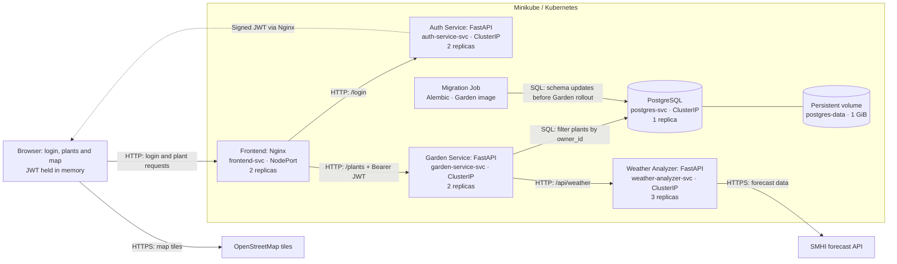

# Smart Garden Architecture

## Overview

Smart Garden lets users log in, manage their own plants, and see watering
advice based on the next 48 hours of weather. Each user has a private garden.
The demo accounts are `demo1 / demo1` and `demo2 / demo2`.

The system has a web frontend, three backend microservices, and a PostgreSQL
database. Docker packages the application, and Kubernetes runs it in Minikube.

## Architecture diagram

## Components and microservice mapping

| Software component | Implementation / deployed service | Responsibility |
|---|---|---|
| User interface and API entry point | `frontend/` → `frontend` Deployment | Show login first. Keep the token in memory and send it with plant requests. Nginx routes `/api/auth/` to Auth and other `/api/` requests to Garden. |
| Login and token issuing | `auth-service/main.py` → `auth-service` microservice | Check fixed demo accounts using password hashes. Sign 30-minute RS256 JWTs with stable user IDs. No users table is needed. |
| Plant management and access control | `garden-service/main.py`, `auth.py`, `schemas.py`, `crud.py` → `garden-service` microservice | Verify JWTs, validate input, and restrict every plant operation to the signed-in user. Add weather to plant reads. |
| Plant storage | `garden-service/models.py`, `database.py` → Garden; `postgres` Deployment stores the data | Store each plant's `owner_id`, name, coordinates, and timestamps on a persistent volume. Only Garden and its migration Job access plant data. |
| Weather integration and watering advice | `weather-service/main.py`, `smhi_client.py`, `forecast.py`, `weather.py` → `weather-analyzer` microservice | Fetch SMHI forecasts, calculate expected precipitation, produce advice, and cache successful results. It does not store plants. |
| Database schema changes | `garden-service/migrations/` → `garden-migrate` Job | Run Alembic migrations using the Garden image before rolling out Garden replicas. |
| Deployment and configuration | `k8s/`, `deploy.sh`, `stop.sh` → Kubernetes resources | Define networking, replicas, health checks, settings, credentials, and storage. Start or remove the application in one call. |

The three backend microservices are independently deployed. The frontend is a
separate web deployment; PostgreSQL and the migration Job support the services.

## How a request works

1. The browser shows a login screen. Nginx forwards `/api/auth/login` to Auth's
   `/login` endpoint. Auth checks the password and returns a signed JWT.
2. The browser keeps the JWT in memory and shows the garden. Plant requests go
   to `/api/plants` with an `Authorization: Bearer` header. Nginx removes `/api`.
3. Garden validates the JWT signature, issuer, audience, expiry, and subject.
   It sets new plants' `owner_id` from the subject and filters all queries by it.
   A plant owned by another user returns `404`. Create, edit, and
   delete requests do not need the Weather Analyzer.
4. For plant reads, Garden asks the Weather Analyzer for each unique location.
   Weather uses its cache or calls SMHI, then returns precipitation and advice.
5. Garden adds the weather result to the plant response. If weather fails,
   the plant is still returned with weather marked as unavailable.

The browser fetches map tiles directly from OpenStreetMap.
Logout clears the token and garden data. Page refresh or token expiry requires
another login. There are no cookies, browser storage, or refresh tokens.
Logout does not revoke an issued token; it expires after 30 minutes.

## Architecture principles and patterns

- **Separate responsibilities:** Garden handles plants and persistence. Weather
  handles forecasts and advice. Auth handles credentials and token issuing.
  Each backend can be changed and scaled separately.
- **Local token validation and user isolation:** Auth alone holds the private
  signing key. Garden holds the public key and verifies tokens without calling
  Auth on each request. The browser cannot choose or change a plant's owner.
- **Service-owned data:** Only Garden and its migration Job access PostgreSQL.
  Other components use APIs rather than reading plant tables directly.
- **Single browser entry point:** Nginx acts as a reverse proxy. Pages and plant
  requests share one origin, so the browser needs no separate backend address or
  application CORS setup.
- **Service discovery and load balancing:** Kubernetes Services provide stable
  DNS names and distribute connections across ready replicas. Only the frontend
  uses a NodePort; the other Services use internal ClusterIP addresses.
- **Stateless replicas:** Backends keep no required user data inside pods.
  Garden stores plants in PostgreSQL. Weather's local cache is disposable, so
  replicas can restart without losing plant records.
- **Cache-aside:** Weather checks its bounded, time-limited cache before calling
  SMHI. Each replica has its own cache, and only successful results are cached.
- **Graceful degradation and bounded calls:** Timeouts and limited concurrency
  keep weather calls bounded. A weather outage leaves plant management working;
  it does not become false zero-rain advice.
- **Health checks and self-healing:** Kubernetes probes check startup, liveness,
  and readiness. It restarts unhealthy containers and sends traffic only to ready
  pods. Garden readiness also checks database access and the schema.
- **External configuration:** ConfigMaps hold settings and a Secret holds
  database credentials. A separate Secret holds JWT keys; only Auth receives
  the private key. Versioned images and a separate migration Job support
  repeatable, ordered releases.
- **Persistent storage:** A PVC keeps PostgreSQL data when its pod is replaced
  or `stop.sh` removes the workloads. The single database replica is not a
  high-availability setup or a backup.
